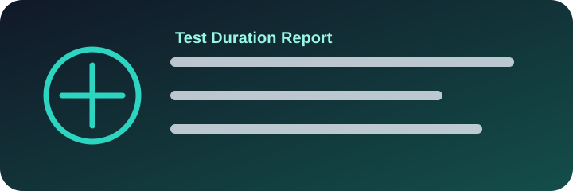

## 🧭 Overview
Parse JUnit XML test results and produce a compact report of slow tests and duration totals.

## ✨ Features
- ⏱️ Rank individual tests by execution time.
- 🧩 Summarize durations by test class or suite.
- 📤 Export machine-readable JSON for CI pipelines.
- 🧪 Work with common JUnit and pytest XML reports.

## 🖥️ Demo
~~~bash
python main.py examples/junit.xml --limit 5
~~~
Try it with the included sample input or your own local files.

## 🚀 Quick Start
~~~bash
git clone https://github.com/CyberLoop-dev/test-duration-report.git
cd test-duration-report
python main.py examples/junit.xml --limit 5
~~~

## 🧰 Tech Stack
- Python 3.10+
- xml.etree.ElementTree, argparse, json (standard library)

## 🗂️ Folder Structure
~~~text
test-duration-report/\n├── assets/icon.svg\n├── examples/junit.xml\n├── tests/test_main.py\n├── LICENSE\n├── README.md\n├── main.py\n└── requirements.txt
~~~

## 🗺️ Roadmap
- [ ] Add HTML report output.
- [ ] Add configurable slow-test thresholds.

## 🤝 Contributing
Issues and focused pull requests are welcome. Add tests for behavior changes and keep the project easy to run locally.

## 📄 License
Released under the MIT License. See LICENSE.

